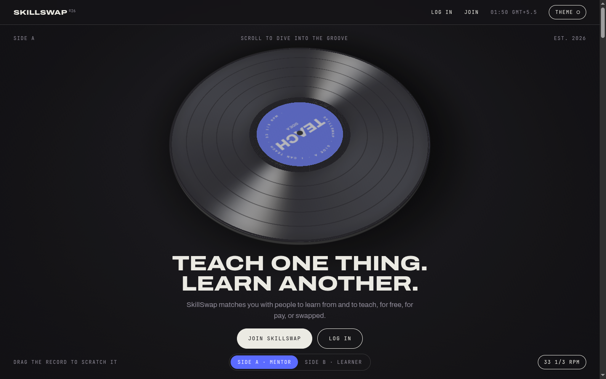
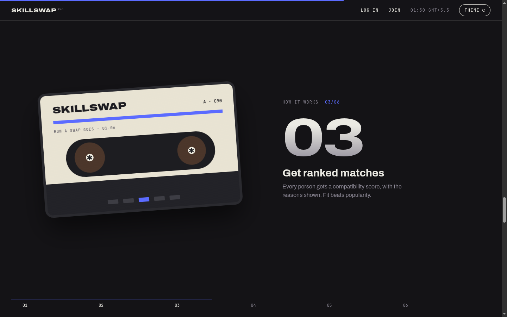
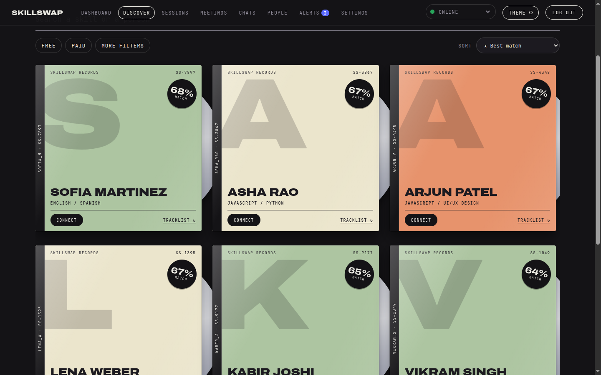
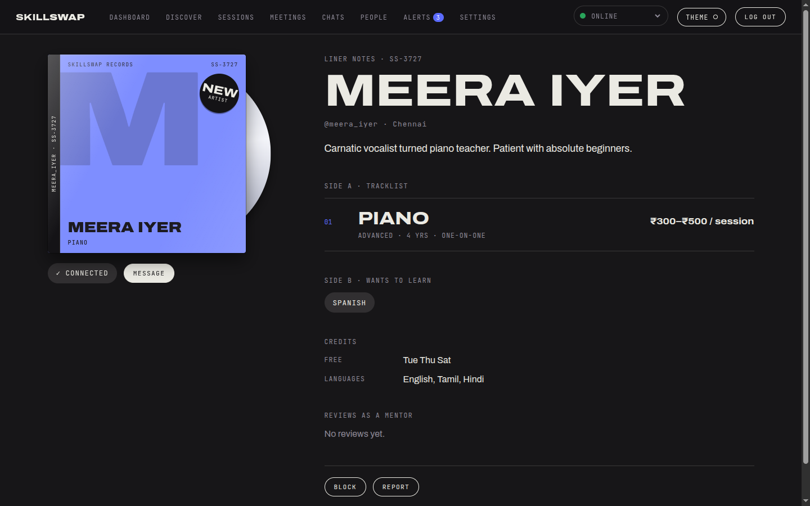
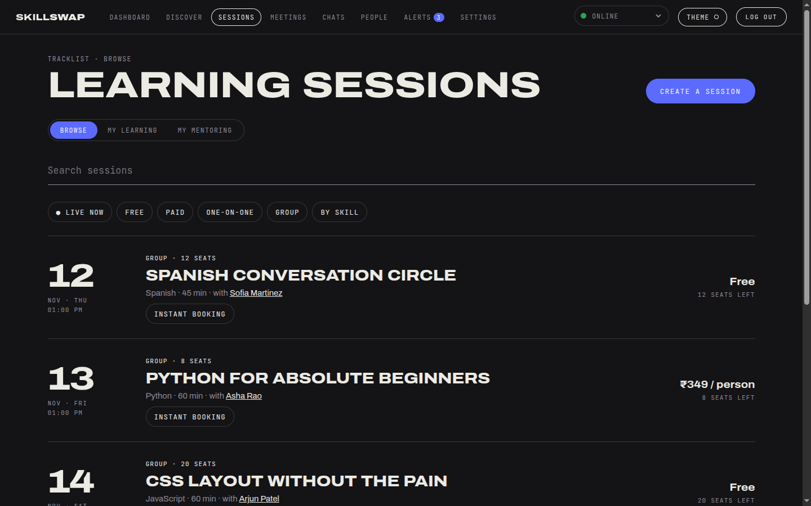
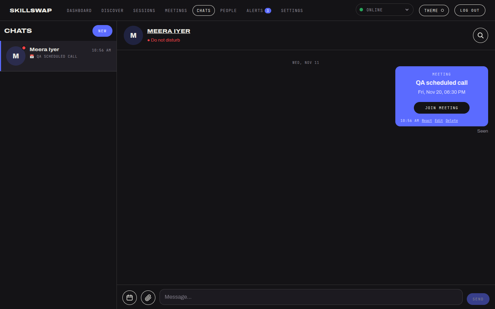
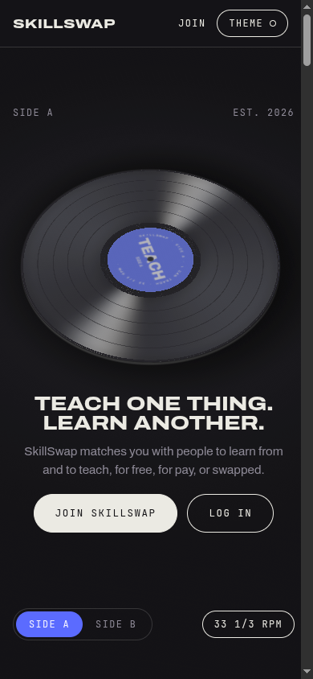
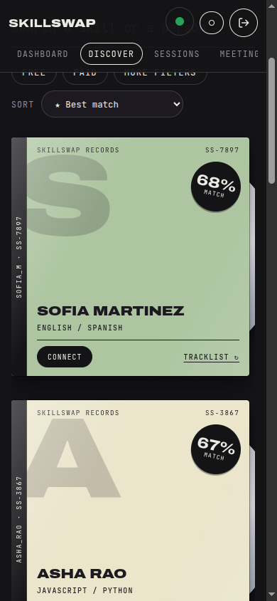

# SkillSwap

**Teach one thing. Learn another.**

SkillSwap is a place where people trade what they know. You list the skills you can teach and the ones you want to learn, and SkillSwap finds the people who fit: someone who teaches what you want, and wants what you teach. You meet them, agree how it works (free, paid, or skill for skill) and learn together in a built-in video room.

**Try it:** [skillswap-eight-chi.vercel.app](https://skillswap-eight-chi.vercel.app)
<sub>The server sleeps on a free plan, so the first visit after a quiet spell can take about a minute to wake up.</sub>



---

## Why SkillSwap

Most people are good at something and want to get better at something else. A guitarist wants to learn Python; a developer wants to learn guitar. Paying a tutor isn't always possible, and asking a stranger for free lessons feels one-sided.

SkillSwap makes it a fair exchange:

- **Everyone is both a Mentor and a Learner.** Your profile has two sides: what you teach and what you want to learn.
- **You choose how value moves.** Teach for free, charge for your time, or swap skill for skill.
- **Matches come with reasons.** Instead of a popularity contest, every person gets a compatibility score that explains itself: same skill, right level, fits your budget, free at the same times, speaks your language.

## How a swap goes



1. **Say what you can teach.** Pick your skills and whether you teach for free, for pay, or as a swap.
2. **Say what you want to learn.** Add your level, budget, languages and when you're free.
3. **Get ranked matches.** Every person gets a score with the reasons shown.
4. **Connect and talk.** Send a request, then chat one-to-one or in groups.
5. **Book and meet.** Book a session, pay securely if it's paid, and join the video room.
6. **Review and repeat.** Rate each other afterwards, then swap roles.

---

## Features

### Find the right people



- **Best Match ranking** weighs skill fit, level, price, time-zone overlap, language, teaching style, ratings and how complete a profile is. Each card shows why it matched.
- **Filters and search** by skill, free or paid, language, day and rating, with 227 skills in 14 categories.
- **People show up as album covers**, so a page of matches feels like a record shop rather than a spreadsheet.

### Profiles that read like liner notes



- **Side A** lists what someone teaches, with level, experience and price. **Side B** lists what they want to learn.
- Availability, languages and two-way reviews (as a Mentor and as a Learner) build trust.
- **Connect, message, block or report** straight from the profile.

### Learning sessions



- **One-on-one or group** sessions, with seat limits that can't be overbooked.
- **Public or private.** Private sessions are invite-only: pick connections to invite and they get a notification.
- **Instant booking or approval**, **weekly repeats** (up to 12 weeks) and an **add to calendar** file.
- **Live now** shows sessions already underway that you can still join.
- Reminders, rescheduling and cancellations, with automatic refunds where the policy says so.

### Chat and meet



- **Direct and group chats** with read receipts, typing indicators, attachments, edits, emoji reactions and search.
- **Status dots** like Discord: set yourself to Online, Away, Do not disturb or Invisible.
- **Schedule a meeting from any chat.** It posts a card with a **Join meeting** button.
- **Built-in video rooms** with screen sharing, a waiting room, host and co-host controls, hand raising, in-room chat, and invites for your connections.

### Payments and earnings

- **Secure checkout with Razorpay** (cards, UPI, netbanking). SkillSwap never sees card details.
- **Mentors keep their whole price.** Learners see the price plus a small platform fee and GST on that fee, broken down before they pay.
- **Fair refunds, automatically.** Cancel 45 minutes or more before a session for a full refund (fee and GST included), and you're always refunded if the Mentor cancels. Disputes go to a person.
- **Mentors get paid out** to the UPI ID or bank account they save in Settings, with no minimum withdrawal, once at least a third of the session has taken place. Receipts and earnings live in the Wallet.

### Accounts and safety

- Sign up with email (verified) or **continue with Google**, then pick a unique User ID.
- Block and report, admin review of reports and disputes, and suspensions that take effect at once.
- **Delete your account** from Settings, confirmed with a code sent to your email.
- Clear [Terms](https://skillswap-eight-chi.vercel.app/terms), [Privacy](https://skillswap-eight-chi.vercel.app/privacy) and [Refund](https://skillswap-eight-chi.vercel.app/refunds) pages.

### Built for phones too

<p align="center">
  
  &nbsp;&nbsp;
  
</p>

Every page works on a phone, in light and dark themes. Screen sharing is the one desktop-only feature, because phone browsers don't support it.

---

## Built with

| | |
|---|---|
| **Website** | React 19 and Vite, plain CSS, a WebGL record on the landing page |
| **Server** | Node 22, Express, Socket.IO for live chat and presence |
| **Database** | PostgreSQL (Neon in production) |
| **Video** | LiveKit |
| **Payments** | Razorpay |
| **Email** | Any SMTP service (Brevo in production) |
| **Hosting** | Vercel (website), Render (server), Neon (database), all on free plans |

A few choices worth knowing:

- **Money is handled carefully.** Amounts are stored in paise, every booking, payment and refund runs in a database transaction, and Razorpay webhooks are signature-checked and safe to receive twice.
- **Logins are server-side sessions** (an httpOnly cookie), so a suspended account is signed out immediately.
- **Everything privileged is checked on the server**, not just hidden in the interface.

## Run it on your computer

You need **Node 22+** and **PostgreSQL 14+**. For video rooms you also need a LiveKit server (`livekit-server --dev` works locally).

```bash
npm install
cp .env.example .env      # set DATABASE_URL and JWT_SECRET
npm run migrate           # creates the tables and the skill catalogue
npm run seed              # optional: 10 demo people and 6 sessions
npm run dev               # website on :5173, server on :4000
```

Open http://localhost:5173. Without email settings, verification and password-reset emails are printed in the server console instead of sent. All variables are explained in [`.env.example`](.env.example).

To make yourself an admin, register, then run `npm run make-admin -w server -- <your-user-id>`.

| Command | What it does |
|---|---|
| `npm run dev` | Website and server together, reloading on changes |
| `npm test` | 62 server tests against a real database |
| `npm run migrate` | Applies new database changes (also runs when the server starts) |
| `npm run seed` | Adds demo data (refuses to run in production) |
| `npm run build -w web` | Builds the website for production |

## Deploy your own

Step by step for the free stack (Vercel, Render and Neon, plus Razorpay, LiveKit and Google sign-in) in **[DEPLOY.md](DEPLOY.md)**.

## Project layout

```
server/src/   auth, people, social, chat, sessions, payments, meetings, admin: one folder per area
server/migrations/   database changes, applied in order
web/src/pages/   one file per screen
web/src/components/   shared pieces: album-cover cards, pickers, the landing record
docs/screenshots/   the images in this README
```

## Status

SkillSwap is live and working end to end: sign-up, matching, chat, sessions, Razorpay payments and refunds, video rooms and admin. The 62 tests cover accounts, matching, connections, chat, bookings (including two people grabbing the last seat at once), payments, refunds, meeting rooms and admin. It runs as a single server, so live presence and timers are kept in memory, and the free plan means reminders only go out while the server is awake.

## History

SkillSwap began as a single-file prototype (`archive/index_1.html`) with mock data. This repository is the full rebuild.
